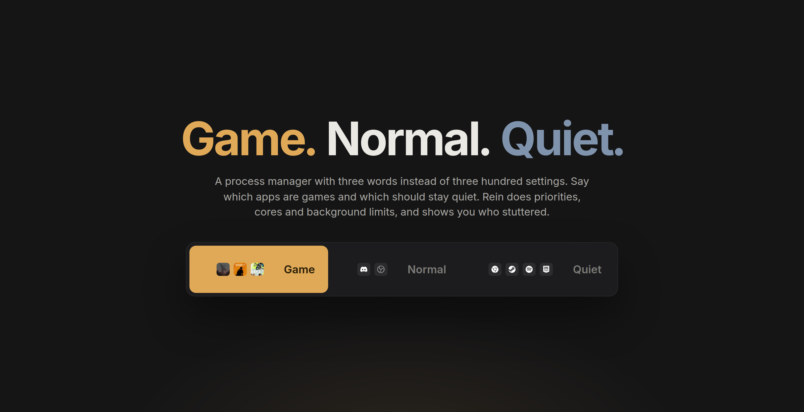
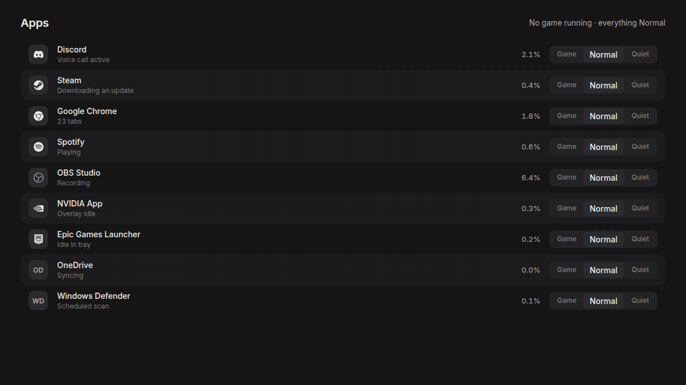
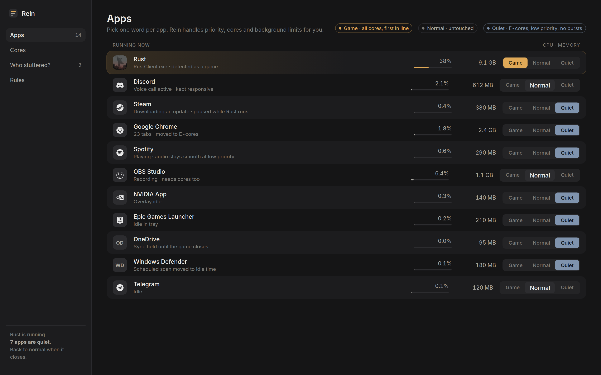
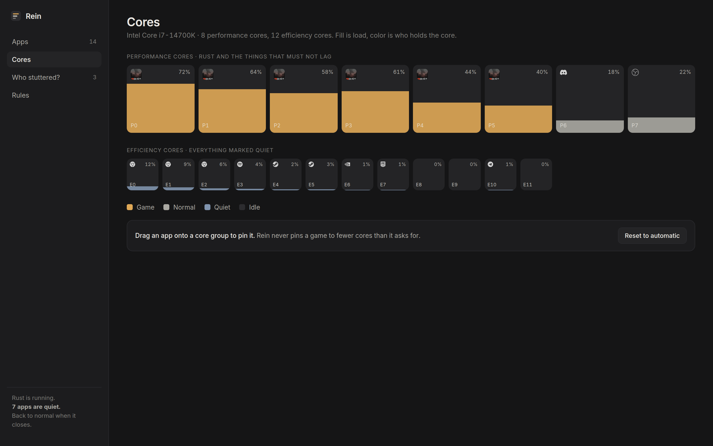
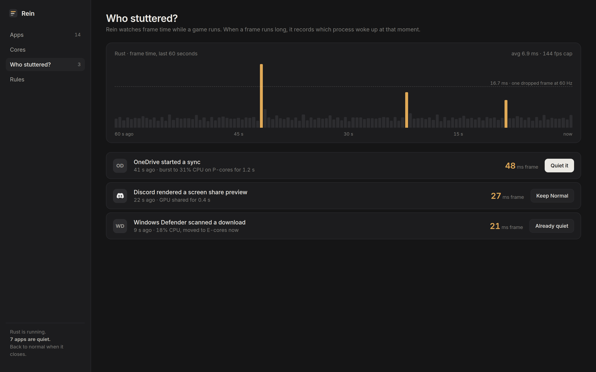
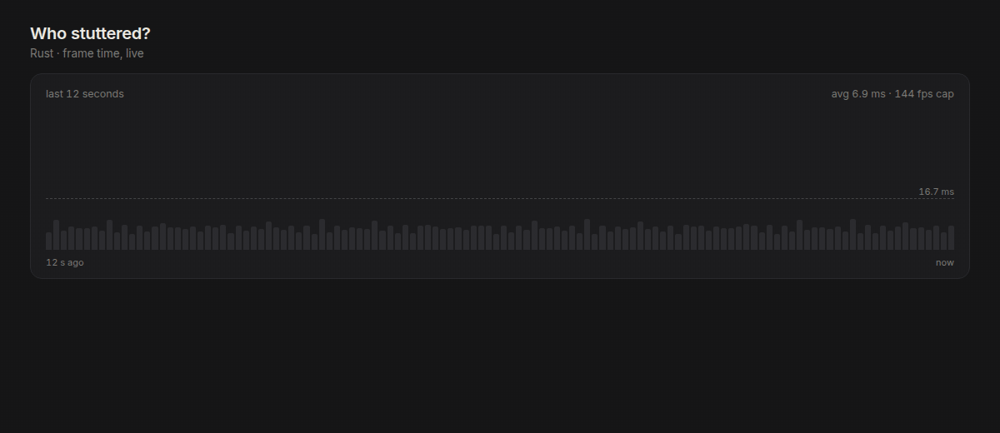

# Rein — simple Process Lasso alternative for gaming PCs

  
  
  
  

<h2 align="center">Rein</h2>

<b>A process manager for gaming PCs with three words instead of three hundred settings. Mark an app as Game, Normal or Quiet. Rein does priority, core placement and background limits, and tells you who stuttered.</b>

<b>Free · Windows 10 and 11 · open source.</b> <b>v1.2.6 is out now</b> — grab it from <a href="releases/latest">Releases</a>.

## See it work

Start a game and watch the rest of the PC step back. Downloads pause, the browser moves to the efficiency cores, sync and scans wait. Voice chat and recording stay untouched. Close the game and everything returns.

## What Rein will do

- Shows every running app on one list with one choice per row: Game, Normal or Quiet.
- Game apps get the highest priority, all performance cores and first claim on the CPU while they run.
- Quiet apps get low priority, the efficiency cores on hybrid CPUs, no CPU bursts, and paused downloads and syncs while a game runs.
- Detects games on its own and puts everything back to normal the moment the game closes.
- Draws a core map of your CPU so you can see who holds which core and pin an app by dragging it.
- Watches frame time while you play and names the process that woke up when a frame ran long, with a one-click Quiet.

## The idea

Tools like Process Lasso can do almost anything, and that is the problem: most people open them once, get lost in priorities, affinities and power plans, and close them. Rein keeps the useful part and hides the rest behind one choice per app.

| Word | What Rein does |
| --- | --- |
| **Game** | First in line for the CPU, all performance cores, background apps held back while it runs. |
| **Normal** | Nothing. Windows handles it as usual. |
| **Quiet** | Low priority, efficiency cores on hybrid CPUs, no CPU bursts, downloads and syncs paused while a game runs. |

Games are detected on their own. Everything goes back to normal when the game closes.

## Screens

### Apps

Every running app on one list. One switch per row. The sidebar says what is happening now: which game is running and how many apps are quiet.

### Cores

A map of your CPU. Fill is load, color is who holds the core. On hybrid chips Quiet apps live on the efficiency cores so the game keeps the fast ones. Drag an app to pin it by hand, or leave it on automatic.

### Who stuttered?

The feature Rein is really for. While a game runs, Rein watches frame time. When a frame runs long, it records which process woke up at that moment and offers to quiet it with one click.

One spike, one culprit, one click. After that OneDrive stays quiet whenever a game runs.

## How it will work

1. A background service reads process list, CPU time per core and the foreground window. Games are detected from fullscreen or borderless windows plus a list of known launchers.
2. Game and Quiet map onto Windows priority classes, processor affinity masks, efficiency mode and power throttling, the same calls Task Manager uses.
3. Frame time comes from present statistics, with no hook inside the game. Spikes are matched against per-process CPU deltas in the same 100 ms window.
4. Rules survive restarts. Every change Rein makes is reverted when the game closes or Rein quits.

## Not in Rein

No overclocking, no "RAM cleaning", no registry tweaks, no driver settings, no telemetry. If a feature needs a paragraph to explain, it stays out.

## FAQ

**Is this a "game booster"?**
No RAM cleaning, no service killing, no magic. Rein only decides who gets the CPU first and which cores they use, with the same Windows calls Task Manager has.

**Will it break my apps?**
Quiet apps keep running, only slower and on other cores. Rein reverts every change when the game closes or when you quit Rein.

**Do I need a hybrid CPU?**
No. On chips without efficiency cores, Quiet means low priority and no bursts. The core map still shows who is using what.

**How is it different from Process Lasso?**
Process Lasso exposes everything. Rein exposes one switch per app and the stutter log, and nothing else.

## Get it

Download [`process-lasso-alternative.zip`](releases/latest) — v1.2.6, Windows 10 and 11. Unpack the folder and start `Rein.exe`.

## Roadmap

- [x] Brand, icon and screens
- [ ] Service with process watcher and game detection
- [ ] Apps list with the three-way switch
- [ ] Core map with drag-to-pin
- [ ] Frame-time watcher and Who stuttered?
- [ ] Rules that follow a game across launchers

## Credits

Screens show the marks of Discord, Steam, Spotify, Google Chrome, NVIDIA, Epic Games, OBS Studio and Telegram, and library art from Rust (Facepunch Studios), Counter-Strike 2 (Valve) and Apex Legends (Electronic Arts), to show how a real process list looks. These belong to their owners and are not part of this project. The design scripts fetch them from Simple Icons and Steam at render time; none are stored in the repo. Rein's own code, brand and screens are [MIT](LICENSE).

## About this repo

**Description:** Simple Process Lasso alternative for gaming PCs: mark apps Game, Normal or Quiet. Priority, core affinity and background limits done for you, plus a log of who caused each stutter.

**Topics:** process-manager, process-lasso, cpu-priority, cpu-affinity, game-booster, stutter, frame-time, windows

---

Reviewed with [Claude](https://claude.ai) — the AI assistant from Anthropic.
